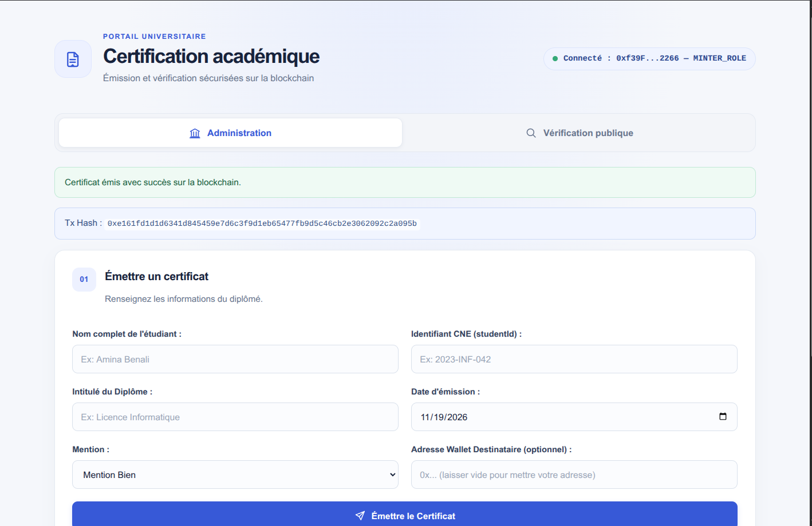
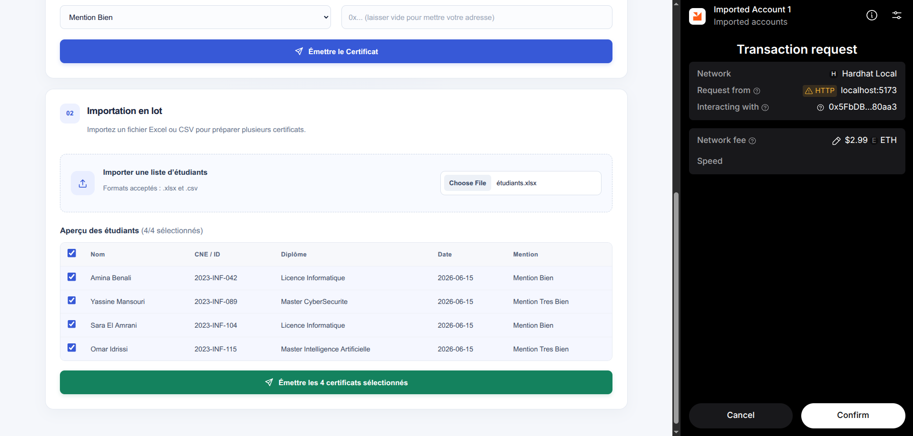
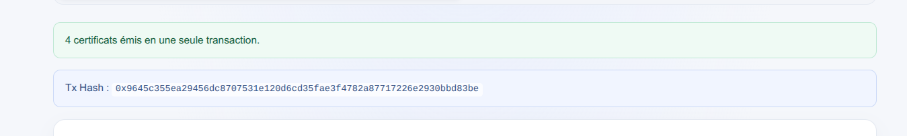
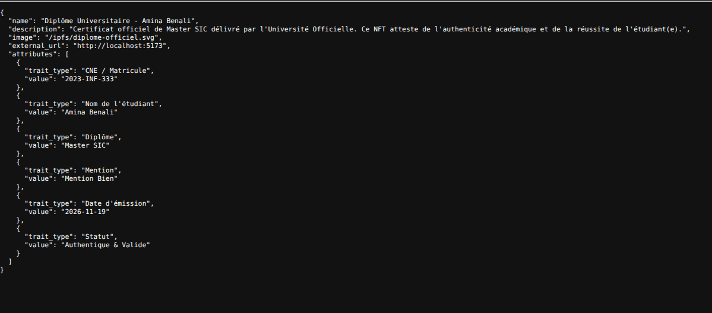
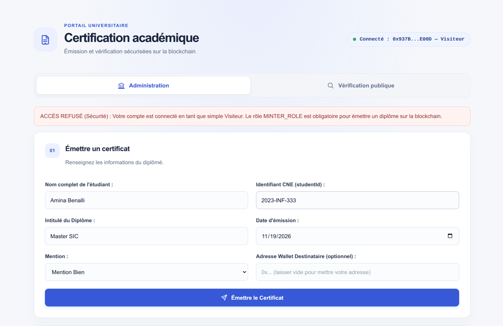
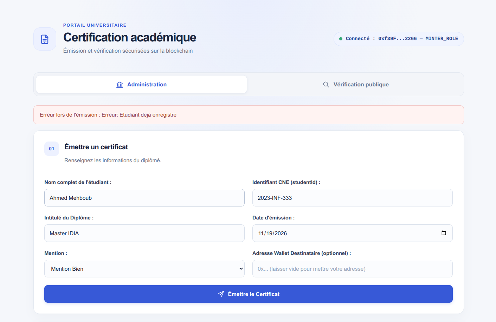

# 🎓 Certification Académique NFT (Standard ERC-721 & Audit de Sécurité) - Devoir 2

Ce projet fait évoluer le système de certification du Devoir 1 vers un standard officiel **ERC-721 (NFT)** sécurisé par les bibliothèques d'**OpenZeppelin v5**, avec une démarche formelle d'audit de sécurité.

---

## 📌 Architecture du Projet

```text
Devoir2_ERC721_Audit/
├── contracts/
│   └── AcademicCertificateNFT.sol  # Contrat ERC-721 (URIStorage, AccessControl, ReentrancyGuard)
├── test/
│   └── AcademicCertificateNFT.test.ts # Tests d'audit et de sécurité (7/7 tests réussis)
├── scripts/
│   └── deploy.ts                   # Script de déploiement Hardhat 3
├── frontend/                       # DApp Web3 React (Vite + SheetJS + ethers.js)
│   ├── src/
│   │   ├── contractConfig.js       # Configuration (Adresse & ABI ERC-721)
│   │   ├── App.jsx                 # Application (Gestion MINTER_ROLE, TokenID, TokenURI)
│   │   └── App.css                 # Mise en page moderne
├── étudiants.xlsx                  # Fichier Excel pour l'import de lot
├── AUDIT_REPORT.md                 # 🛡️ Rapport d'audit de sécurité formel
├── hardhat.config.ts               # Configuration Hardhat (viaIR activé)
└── README.md
```

---

## 🛡️ Audit de Sécurité & Rapport Formel

Le rapport d'audit détaillé de 2 pages couvrant le périmètre, les vulnérabilités analysées (Access Control, Reentrancy, Overflow, DoS, Anti-doublon) et les recommandations d'architecture se trouve dans :
👉 [`AUDIT_REPORT.md`](AUDIT_REPORT.md)

### Exécution des Tests d'Audit Automatisés :

```bash
npx hardhat test
```

**Résultat :**
```text
  AcademicCertificateNFT - Tests de Sécurité & Audit (ERC-721)
    ✔ 1. L'Admin et le Minter doivent posséder les bons rôles OpenZeppelin
    ✔ 2. Le compte Minter peut émettre un NFT ERC-721 valide pour l'étudiant
    ✔ 3. Sécurité : Un compte sans MINTER_ROLE ne peut pas émettre de diplôme
    ✔ 4. Sécurité : Rejette l'adresse nulle et les champs obligatoires vides
    ✔ 5. Sécurité : Bloque formellement l'émission de deux diplômes avec le même CNE
    ✔ 6. L'émission groupée (Batch Mint) attribue correctement chaque NFT à son propriétaire
    ✔ 7. Seul l'ADMIN peut révoquer un diplôme, un pirate est rejeté

  7 passing (514ms)
```

---

## ⚙️ Déploiement & Démarrage

### 1. Démarrer le nœud local Hardhat (Terminal 1)
```bash
npx hardhat node
```

### 2. Déployer le contrat ERC-721 (Terminal 2)
```bash
npx hardhat run scripts/deploy.ts --network localhost
```
- **Contrat déployé :** `0x5FbDB2315678afecb367f032d93F642f64180aa3`
- **Admin & Minter initial :** `0xf39Fd6e51aad88F6F4ce6aB8827279cffFb92266`

### 3. Lancer le Frontend (Terminal 3)
```bash
cd frontend
npm run dev
```
Accès : `http://localhost:5173/`.

---

## 📸 Démonstration en Images (Cycle Complet)

### 1. Contrôle d'Accès & Détection du Rôle MINTER_ROLE
Le frontend interroge le contrat et identifie immédiatement les droits administratifs du compte connecté :


### 2. Émission Unitaire d'un Diplôme NFT (ERC-721)
Création d'un premier certificat avec signature cryptographique MetaMask et confirmation on-chain :



### 3. Importation Excel & Signature du Batch Mint
SheetJS extrait les 4 étudiants du fichier `étudiants.xlsx` et déclenche une demande de signature globale :



### 4. Validation et Confirmation du Batch Mint
Les 4 diplômes NFT sont enregistrés simultanément dans le même bloc avec un hash de transaction unique :



### 5. Consultation Publique & Métadonnées du NFT (Standard ERC-721)
Vérification publique sans permission restituant le **Token ID (#1)**, le lien **Token URI (IPFS)** et l'adresse du propriétaire **ownerOf** :

<p align="center">
  
</p>

**Consulter JSON**



## 🚨 Démonstration de la Robustesse (Tests de Sécurité & Gestion des Erreurs)

### 6. Cas d'Erreur 1 : Tentative d'émission par un compte Invité (Accès Refusé)
Un compte non autorisé (`0x937B...E00D - Visiteur`) tente d'émettre un diplôme. L'application bloque l'action et affiche un avertissement de sécurité sans gaspiller de gas :



### 7. Cas d'Erreur 2 : Tentative de Double Enregistrement (Anti-Doublon on-chain)
L'administrateur tente d'émettre un diplôme pour un autre étudiant (*Ahmed Mehboub*) en réutilisant un CNE déjà enregistré (*2023-INF-333*). Le Smart Contract rejette la transaction via la règle `require(!_registeredStudents[studentId])` :

