# CyberSecurite

<details open>
<summary><b>Atelier 1: Blockchain</b> | <a href="Td1_blockchain"><code>Td1_blockchain</code></a> | $\color{red}{\text{(Click to open / close)}}$</summary>

<br>

**EXERCICE 1:** [`Td1_blockchain/merkle.cpp`](Td1_blockchain/merkle.cpp)

#### Run:

```bash    
g++ merkle.cpp -o merkle -lcrypto && ./merkle 
```
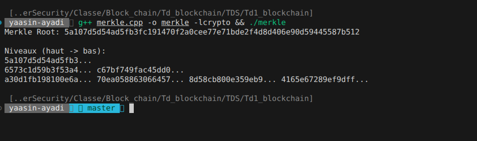

---

**EXERCICE 2:** [`Td1_blockchain/pow.cpp`](Td1_blockchain/pow.cpp)

#### RUN: 
    
```bash
g++ pow.cpp -o pow -lcrypto && ./pow 
```
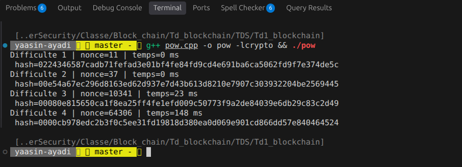

---

**EXERCICE 3:**  [`Td1_blockchain/pos.cpp`](Td1_blockchain/pos.cpp)

#### RUN: 
    
```bash
g++ pos.cpp -o pos -lcrypto && ./pos 
```
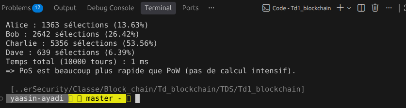

---

**EXERCICE 4:** [`Td1_blockchain/blockchain.cpp`](Td1_blockchain/blockchain.cpp)

#### RUN: 
    
```bash
g++ blockchain.cpp -o blockchain -lcrypto && ./blockchain 
```
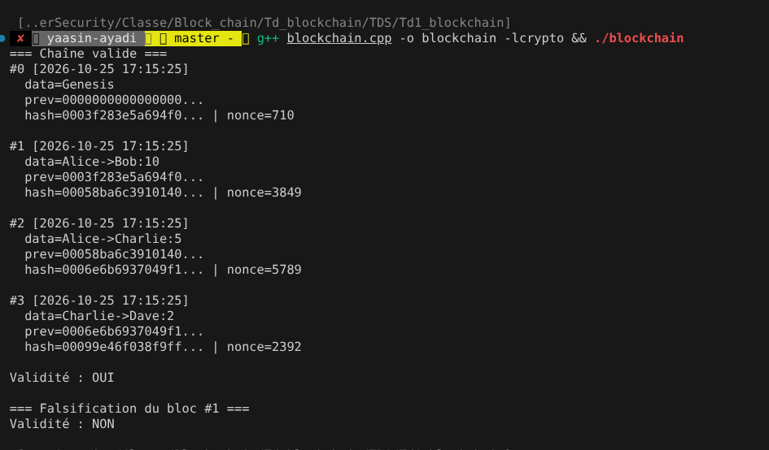
</details>

<!-------------------->
---
<details open>

<summary><b>Atelier 2: Plateforme de Simulation d'attaques</b> | <a href="Td2_blockchain"><code>Td2_blockchain</code></a> | $\color{red}{\text{(Click to open / close)}}$</summary>

<br>

**Plateforme Globale: Simulation, Detection & Evaluation des Attaques** : [`Td2_blockchain/plateforme.cpp`](Td2_blockchain/plateforme.cpp)

*Cette plateforme simule les 4 attaques (51% & Double Spending, Selfish Mining, Block Withholding et Sybil Attack), intègre les métriques de détection avec contre-mesures, et affiche une évaluation comparative (Normale vs Attaquée vs Protégée).*

#### Run:
```bash    
g++ attack_51.cpp -o attack_51 -lcrypto && ./attack_51
``` 
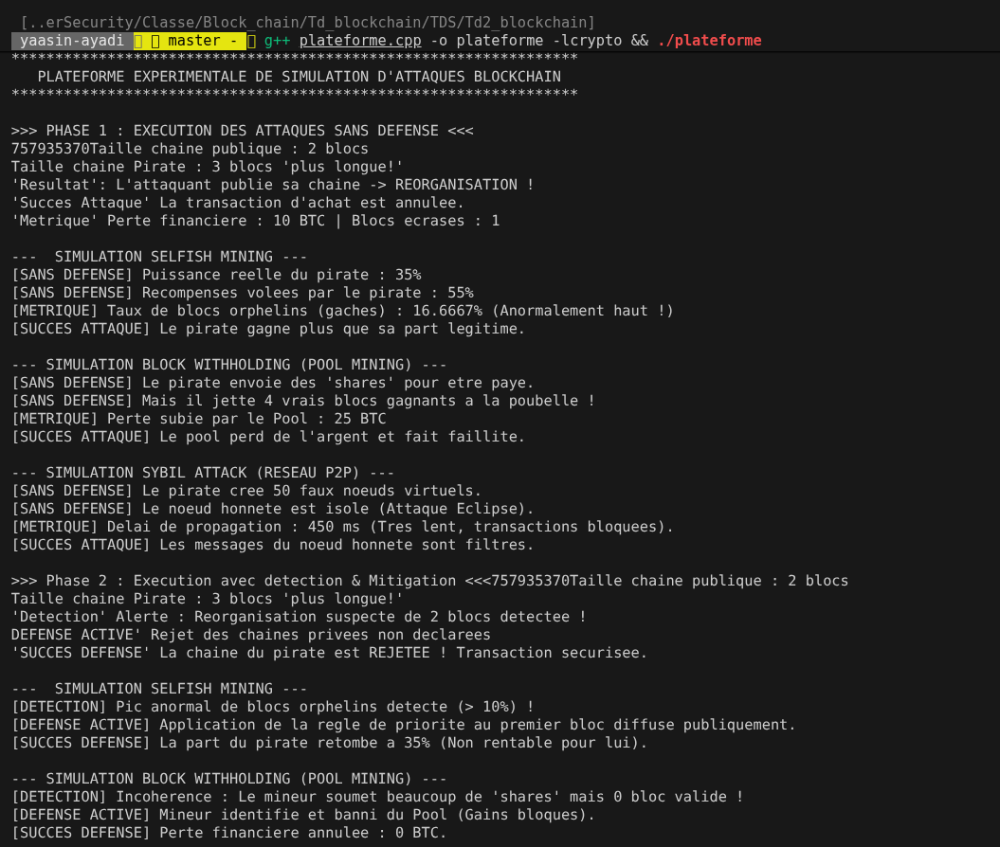
###### Suite Execution:
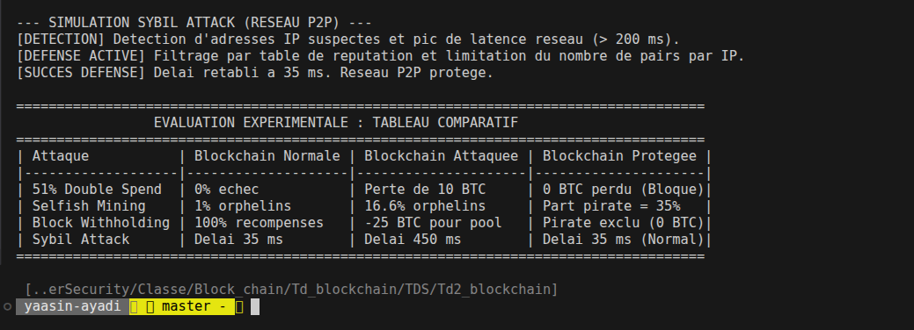
</details>

<!-------------------->
---

<details open>
<summary><b>Atelier 3: Smart Contract "Mini Réseau Social" en Solidity</b> | <a href="Td3_blockchain"><code>Td3_blockchain</code></a> | $\color{red}{\text{(Click to open / close)}}$</summary>

<br>

**SMART CONTRACT : MiniSocial** : [`Td3_blockchain/MiniSocial.sol`](Td3_blockchain/MiniSocial.sol)

*Développement, déploiement sur le réseau de test Ethereum Sepolia et interactions multi-utilisateurs via MetaMask et Remix IDE.*

#### Adresse du Contrat Déployé (Sepolia) :
`0x3c4cd92AEe82b92AE8F311505E6B249d27Ab53D7`

#### Étapes Réalisées :
1. **Déploiement du contrat** : Déployé via Remix IDE connecté à MetaMask sur le réseau Sepolia.
2. **Publication Multi-Comptes (`publishPost`)** :
   - Message 1 : Publié par le **Compte 1** (`0x066...44712`).
   - Message 2 : Publié par le **Compte 2** (`0x937...4e00d`).
3. **Tests de Consultation des Données** :
   - Récupération du contenu et identification de l'auteur (`getPost`).
   - Calcul dynamique du total des publications (`getTotalPosts`).

#### Résultats d'Exécution :

##### A. Tests sur Remix IDE :
**1. Consultation d'un post via `getPost` (Message & Adresse de l'Auteur) :**

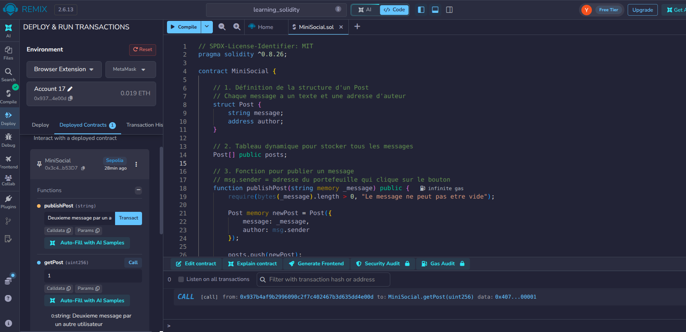

**2. Consultation du nombre total de messages via `getTotalPosts` :**

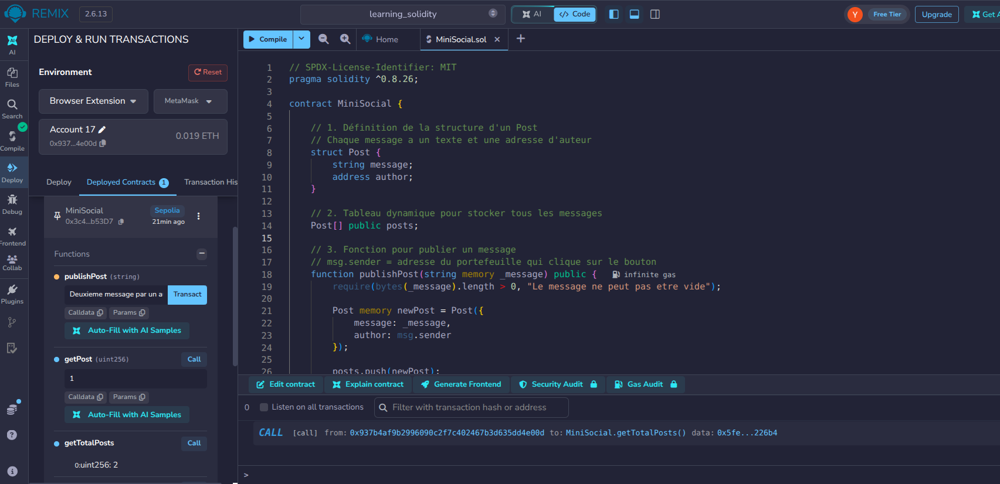

---

##### B. Tests en Direct sur la DApp Web3 :
**3. Publication d'un message & Demande de signature via MetaMask :**

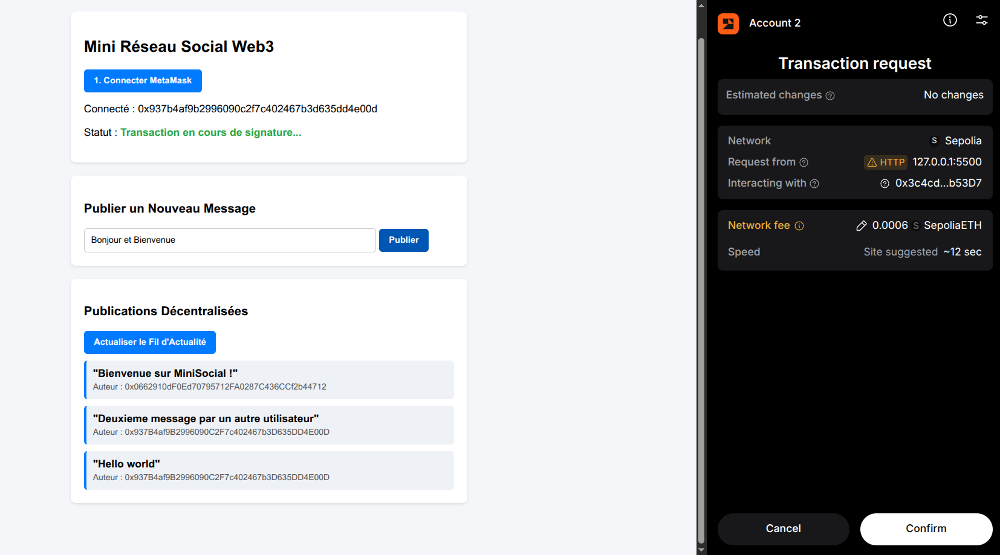

**4. Confirmation sur le réseau Sepolia & Actualisation du fil (4 messages validés) :**

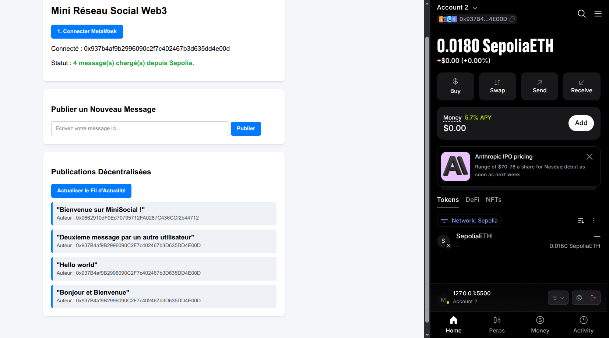

---

</details>


<!-- ========================================== -->
<!-- DEVOIR 1 -->
<!-- ========================================== -->
---

<details open>
<summary><b>Devoir 1: Système de Certification Académique sur Blockchain</b> | <a href="Devoir1_Certification"><code>Devoir1_Certification</code></a> | $\color{red}{\text{(Click to open / close)}}$</summary>

<br>

> 📘 **Documentation Complète & Guide d'Installation :**  
> L'ensemble du protocole technique, des commandes de déploiement et des détails d'architecture se trouve dans le fichier dédié : [`Devoir1_Certification/README.md`](Devoir1_Certification/README.md).

<br>


**Solution décentralisée de bout en bout pour la certification de diplômes universitaires (Smart Contract + Frontend React + Import Excel SheetJS).**

- **Smart Contract & Sécurité** : [`Devoir1_Certification/contracts/CertificateRegistry.sol`](Devoir1_Certification/contracts/CertificateRegistry.sol) *(6/6 tests unitaires automatisés validés)*.
- **Application Web3 Frontend** : [`Devoir1_Certification/frontend/src/App.jsx`](Devoir1_Certification/frontend/src/App.jsx).
- **Modèle de Données Excel** : [`Devoir1_Certification/étudiants.xlsx`](Devoir1_Certification/étudiants.xlsx).
- **Réseau & Adresse Déployée** : Hardhat Local (`0x5FbDB2315678afecb367f032d93F642f64180aa3`).

---

#### Résultats d'Exécution & Démonstration :

**1. Émission unitaire d'un certificat avec signature MetaMask :**

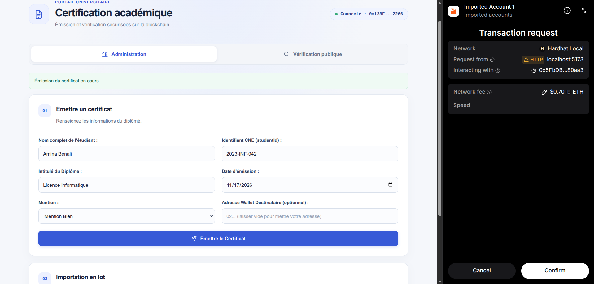

**2. Importation Excel (.xlsx) et émission groupée Batch Mint :**

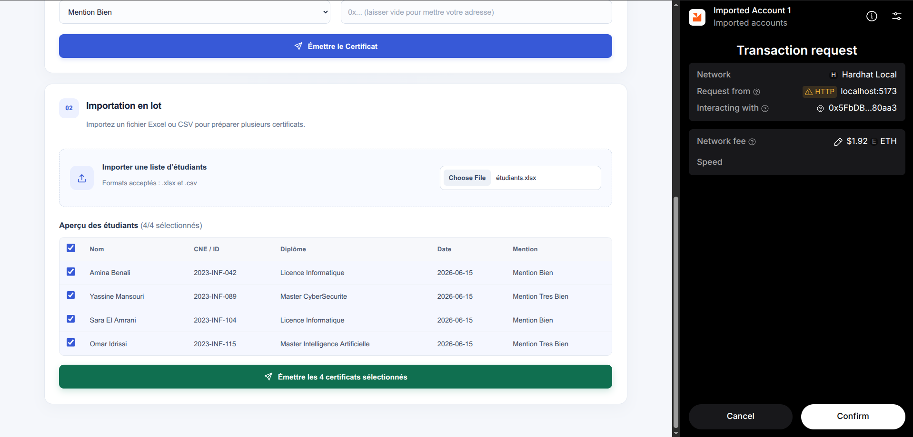

**3. Consultation et vérification publique du diplôme sur la Blockchain :**

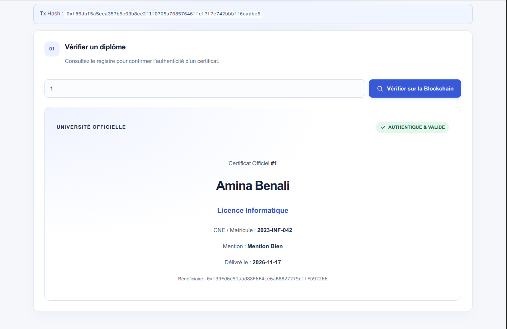

---

</details>


<!-- ========================================== -->
<!-- DEVOIR 2 -->
<!-- ========================================== -->
---

<details open>
<summary><b>Devoir 2: Standards ERC & Audit des Smart Contracts (ERC-721)</b> | <a href="Devoir2_ERC721_Audit"><code>Devoir2_ERC721_Audit</code></a> | $\color{red}{\text{(Click to open / close)}}$</summary>

<br>

> 🛡️ **Rapport d'Audit Formel & Documentation :**  
> Retrouvez le rapport d'audit de sécurité complet dans [`Devoir2_ERC721_Audit/AUDIT_REPORT.md`](Devoir2_ERC721_Audit/AUDIT_REPORT.md) ainsi que le guide technique dans [`Devoir2_ERC721_Audit/README.md`](Devoir2_ERC721_Audit/README.md).

<br>

**Migration vers le standard officiel Ethereum ERC-721 (NFT), intégration d'OpenZeppelin v5 (`AccessControl`, `ERC721URIStorage`, `ReentrancyGuard`) et audit de sécurité.**

- **Smart Contract ERC-721** : [`Devoir2_ERC721_Audit/contracts/AcademicCertificateNFT.sol`](Devoir2_ERC721_Audit/contracts/AcademicCertificateNFT.sol).
- **Tests d'Audit de Sécurité** : [`Devoir2_ERC721_Audit/test/AcademicCertificateNFT.test.ts`](Devoir2_ERC721_Audit/test/AcademicCertificateNFT.test.ts) *(7/7 tests validés)*.
- **Rapport d'Audit de Sécurité** : [`Devoir2_ERC721_Audit/AUDIT_REPORT.md`](Devoir2_ERC721_Audit/AUDIT_REPORT.md).
- **Application Web3 Frontend** : [`Devoir2_ERC721_Audit/frontend/src/App.jsx`](Devoir2_ERC721_Audit/frontend/src/App.jsx).
- **Adresse Déployée (Hardhat Local)** : `0x5FbDB2315678afecb367f032d93F642f64180aa3`.

---

#### Démonstration & Résultats des Tests :

**1. Détection automatique du rôle (MINTER_ROLE) :**

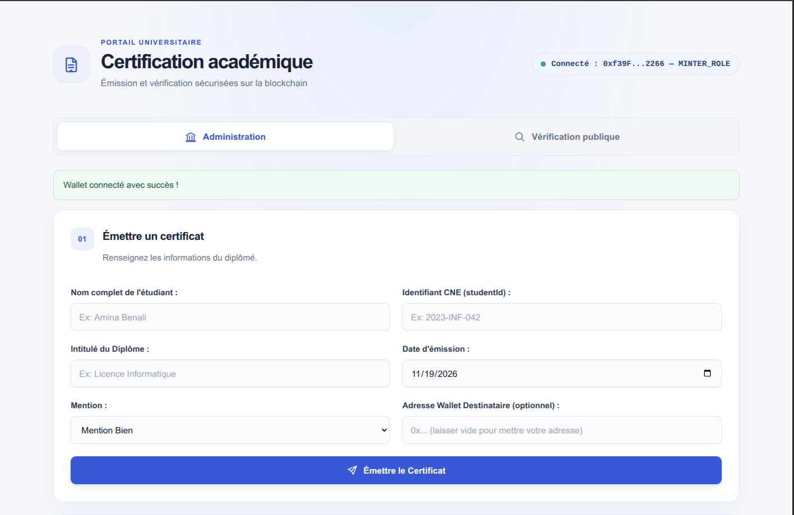

**2. Émission unitaire d'un diplôme NFT avec signature MetaMask :**

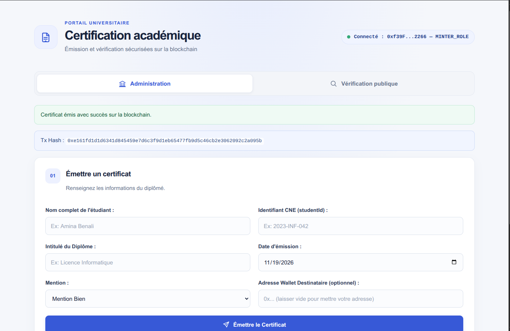

**3. Importation Excel SheetJS et demande de transaction Batch :**

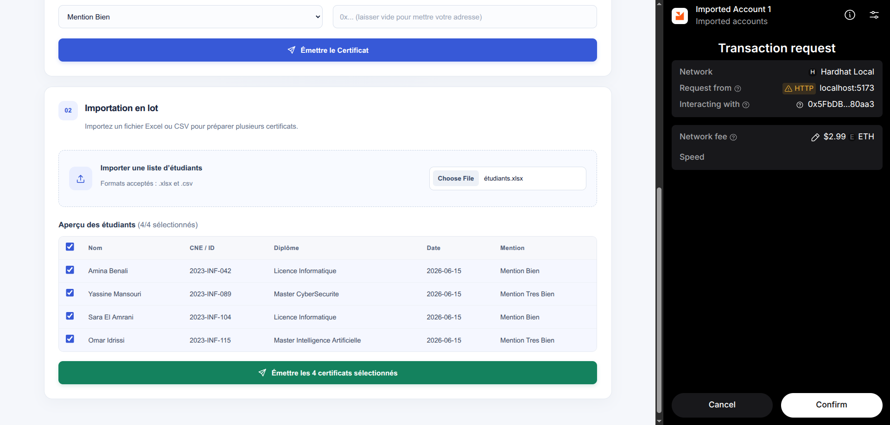

**4. Confirmation de l'émission groupée Batch Mint :**

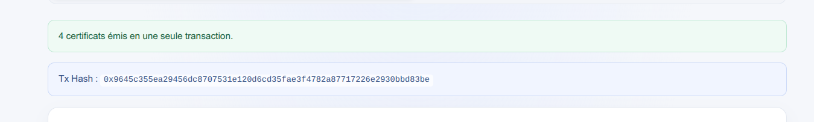

**5. Consultation et vérification publique du NFT (Token ID #1, Token URI & Propriétaire) :**

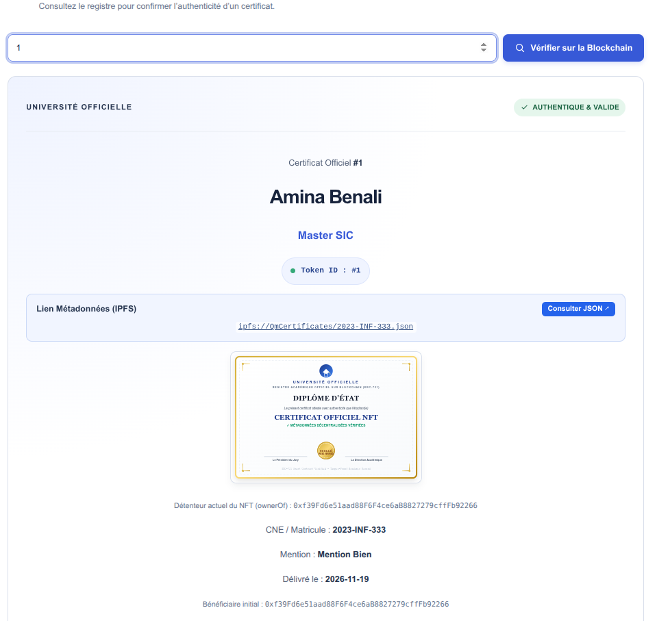

---

</details>