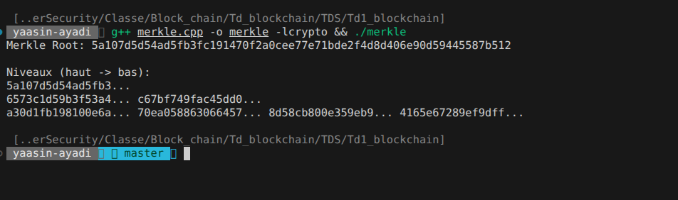
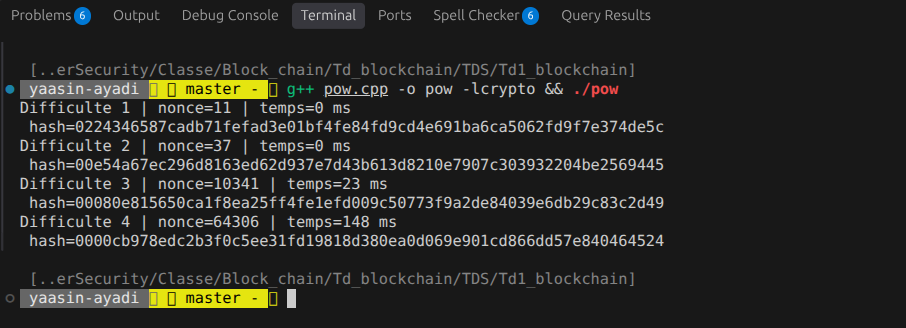
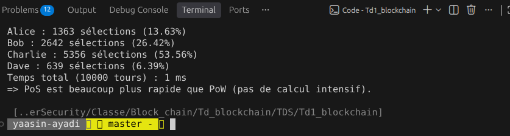
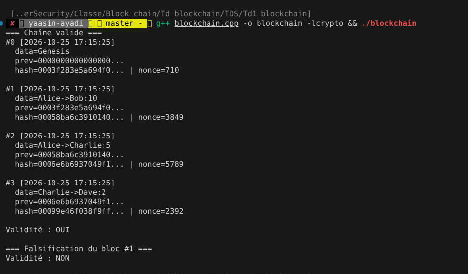
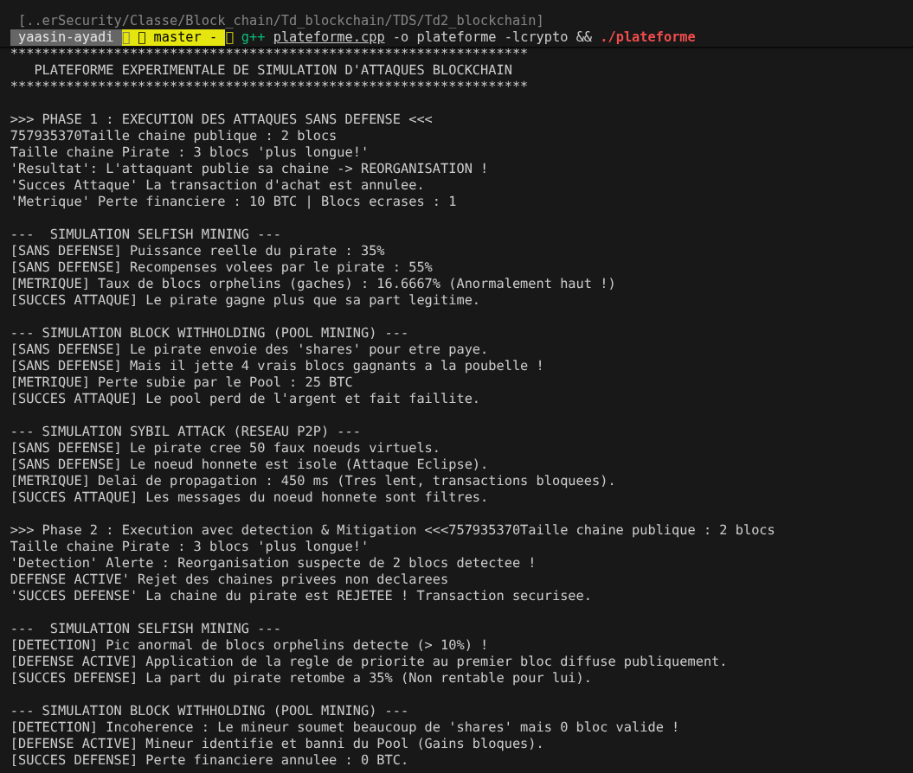
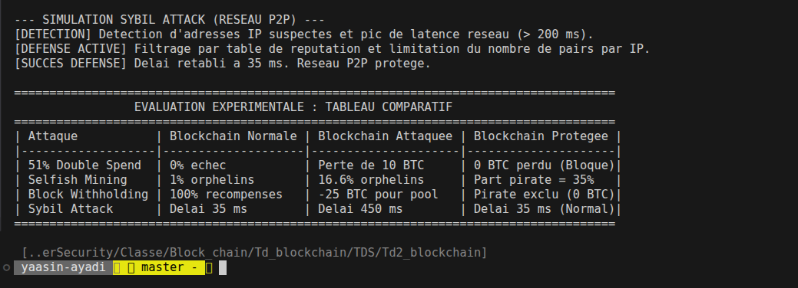
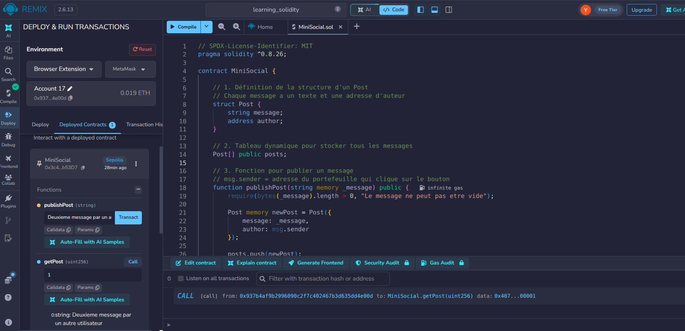
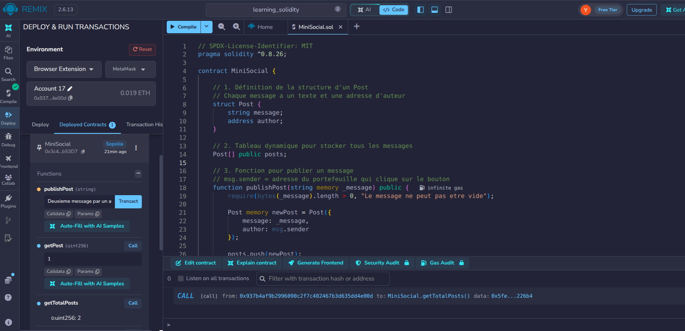

# CyberSecurite

<details open>
<summary><b>TD1: Blockchain</b> | [`Td1_blockchain`](Td1_blockchain) | $\color{red}{\text{(Click to open / close)}}$</summary>

<br>

**EXERCICE 1:** [`Td1_blockchain/merkle.cpp`](Td1_blockchain/merkle.cpp)

#### Run:

```bash    
g++ merkle.cpp -o merkle -lcrypto && ./merkle 
```


---

**EXERCICE 2:** [`Td1_blockchain/pow.cpp`](Td1_blockchain/pow.cpp)

#### RUN: 
    
```bash
g++ pow.cpp -o pow -lcrypto && ./pow 
```


---

**EXERCICE 3:**  [`Td1_blockchain/pos.cpp`](Td1_blockchain/pos.cpp)

#### RUN: 
    
```bash
g++ pos.cpp -o pos -lcrypto && ./pos 
```


---

**EXERCICE 4:** [`Td1_blockchain/blockchain.cpp`](Td1_blockchain/blockchain.cpp)

#### RUN: 
    
```bash
g++ blockchain.cpp -o blockchain -lcrypto && ./blockchain 
```

</details>

<!-------------------->
---
<details open>

<summary><b>Atelier 2: Plateforme de Simulation d'attaques</b> | [`Td2_blockchain`](Td2_blockchain) | $\color{red}{\text{(Click to open / close)}}$</summary>

<br>

**Plateforme Globale: Simulation, Detection & Evaluation des Attaques** : [`Td2_blockchain/plateforme.cpp`](Td2_blockchain/plateforme.cpp)

*Cette plateforme simule les 4 attaques (51% & Double Spending, Selfish Mining, Block Withholding et Sybil Attack), intègre les métriques de détection avec contre-mesures, et affiche une évaluation comparative (Normale vs Attaquée vs Protégée).*

#### Run:
```bash    
g++ attack_51.cpp -o attack_51 -lcrypto && ./attack_51
``` 

###### Suite Execution:

</details>

<!-------------------->
---

<details open>
<summary><b>Atelier 3: Smart Contract "Mini Réseau Social" en Solidity</b> | [`Td3_blockchain`](Td3_blockchain) | $\color{red}{\text{(Click to open / close)}}$</summary>

<br>

**SMART CONTRACT : MiniSocial** : [`Td3_blockchain/MiniSocial.sol`](Td3_blockchain/MiniSocial.sol)

*Développement, déploiement sur le réseau de test Ethereum Sepolia et interactions multi-utilisateurs via MetaMask et Remix IDE.*

#### Adresse du Contrat Déployé (Sepolia) :
`0x3c48972E9c855a1be2e6f42a5a04eb92408b53D7`

#### Étapes Réalisées :
1. **Déploiement du contrat** : Déployé via Remix IDE connecté à MetaMask sur le réseau Sepolia.
2. **Publication Multi-Comptes (`publishPost`)** :
   - Message 1 : Publié par le **Compte 1** (`0x066...44712`).
   - Message 2 : Publié par le **Compte 2** (`0x937...4e00d`).
3. **Tests de Consultation des Données** :
   - Récupération du contenu et identification de l'auteur (`getPost`).
   - Calcul dynamique du total des publications (`getTotalPosts`).

#### Résultats d'Exécution :

**1. Consultation d'un post via `getPost` (Message & Adresse de l'Auteur) :**



**2. Consultation du nombre total de messages via `getTotalPosts` :**



---

</details>

