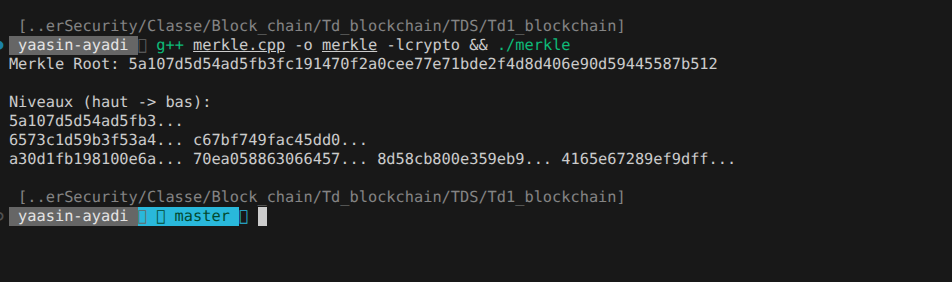
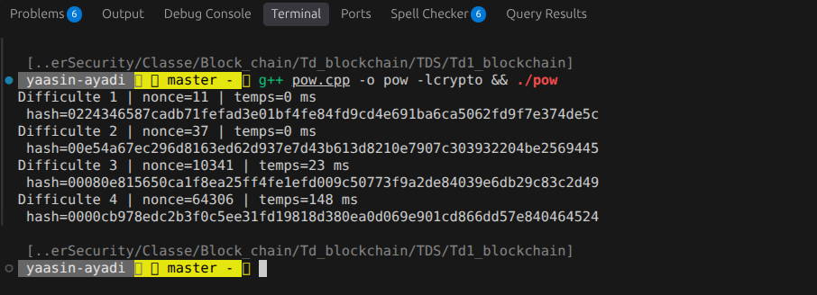
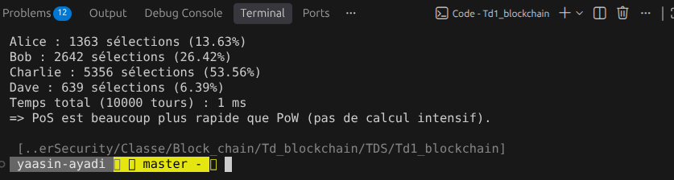
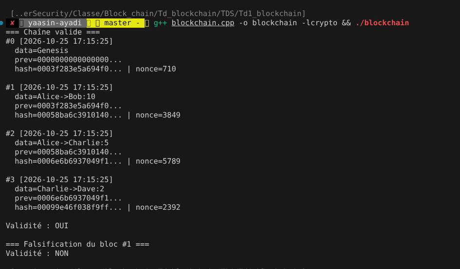

# CyberSecurite

<details open>
<summary><b>TD1: Blockchain</b> | $\color{red}{\text{(Click to open / close)}}$</summary>

<br>

**EXERCICE 1:** <u>Td1_blockchain\merkle.cpp</u>

#### Run:

```bash    
g++ merkle.cpp -o merkle -lcrypto && ./merkle 
```


---

**EXERCICE 2:** <u>Td1_blockchain\pow.cpp</u>

#### RUN: 
    
```bash
g++ pow.cpp -o pow -lcrypto && ./pow 
```


---

**EXERCICE 3:**  <u>Td1_blockchain\pos.cpp</u>

#### RUN: 
    
```bash
g++ pow.cpp -o pow -lcrypto && ./pow 
```


---

**EXERCICE 4:** <u>Td1_blockchain\blockchain.cpp</u>

#### RUN: 
    
```bash
g++ pow.cpp -o pow -lcrypto && ./pow 
```

</details>